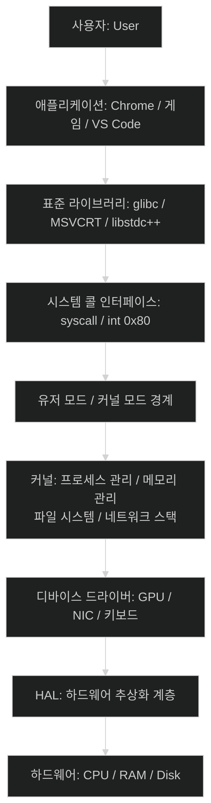
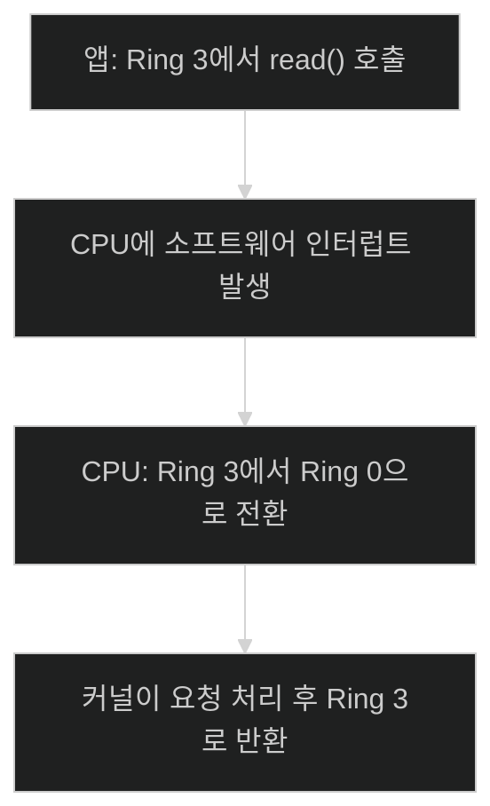

## 개요

운영체제는 단일 덩어리가 아니라 역할에 따라 여러 계층으로 나뉘어 설계됩니다. 각 계층은 바로 아래 계층에만 의존하고, 위 계층에 서비스를 제공하는 구조입니다.

---

## 전체 계층 구조

---

## 각 계층 설명

### 하드웨어 (Hardware)

물리적인 장치 그 자체. CPU, RAM, 저장장치, NIC, GPU 등.

### HAL - 하드웨어 추상화 계층

다양한 하드웨어를 동일한 인터페이스로 감싸서 커널이 하드웨어 종류에 상관없이 동일한 방식으로 다룰 수 있게 해줌.

- Windows: `hal.dll`이 명시적으로 존재
- Linux: 드라이버가 HAL 역할을 분산 담당

### 디바이스 드라이버

특정 하드웨어 장치를 OS가 제어할 수 있도록 만든 소프트웨어. 커널 모드(Ring 0)에서 실행. 드라이버 버그 = BSOD / 커널 패닉.

### 커널 (Kernel)

OS의 핵심. 하드웨어와 소프트웨어 사이의 모든 중재를 담당.

- 프로세스 스케줄러, 메모리 관리자, VFS, 네트워크 스택, IPC, 보안/권한 관리
- 설계 방식: 모놀리식(Linux), 마이크로커널(QNX), 하이브리드(Windows NT, macOS XNU)

### 시스템 콜 인터페이스

유저 모드 앱이 커널 기능을 요청하는 유일한 공식 통로.

### 표준 라이브러리

시스템 콜을 감싸서 개발자가 쓰기 편한 함수로 제공.

- Linux: glibc / Windows: MSVCRT / macOS: libSystem
- 예: `printf()` → glibc → `write()` 시스템 콜 → 커널

### 애플리케이션

최상위 계층. 대부분의 경우 표준 라이브러리만 직접 호출.

---

## 계층 구조의 이점

- 추상화: 앱 개발자는 하드웨어 세부사항을 몰라도 됨
- 이식성: HAL과 드라이버 계층이 하드웨어 차이를 흡수 (Linux가 x86, ARM, RISC-V에서 동작하는 이유)
- 보안: 유저 모드 / 커널 모드 경계로 앱이 커널을 직접 건드리지 못하게 막음

---

## 요약 테이블

| 계층 | 역할 | 실행 모드 |
| --- | --- | --- |
| 애플리케이션 | 사용자 기능 제공 | 유저 모드 |
| 표준 라이브러리 | 시스템 콜 래핑 | 유저 모드 |
| 시스템 콜 인터페이스 | 유저↔커널 통신 창구 | 경계 |
| 커널 | 자원 관리, 중재 | 커널 모드 |
| 디바이스 드라이버 | 하드웨어 제어 | 커널 모드 |
| HAL | 하드웨어 추상화 | 커널 모드 |
| 하드웨어 | 물리 장치 | - |
