## 개요

Kubernetes 인프라 패키지를 Helm과 Argo CD로 어떻게 관리하는 것이 좋은가?

다음과 같은 구조로 구성하는 방식이 꽤 일반적이고 관리하기 좋은 방식입니다.

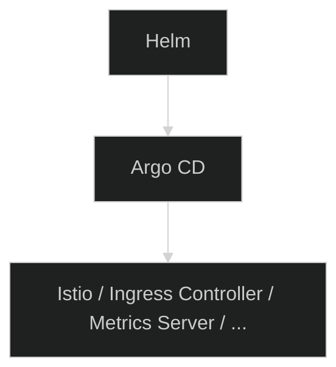

핵심은 "Helm은 최초 Argo CD 설치를 위한 Bootstrap 도구로 사용하고, Argo CD가 올라온 이후부터는 대부분의 Kubernetes 인프라 패키지를 GitOps 방식으로 관리한다"는 것입니다.

즉 역할을 다음처럼 나누는 것입니다.

```
Helm = Argo CD를 Kubernetes에 최초 설치
Argo CD = 이후 Kubernetes 내부 패키지들의 배포 및 상태 관리
Helm Chart = Argo CD가 배포할 패키지 포맷 중 하나
Git = 실제 원하는 상태(Desired State)를 저장하는 기준점
```

---

## 전체 구조

가장 이해하기 쉽게 표현하면 다음과 같습니다.

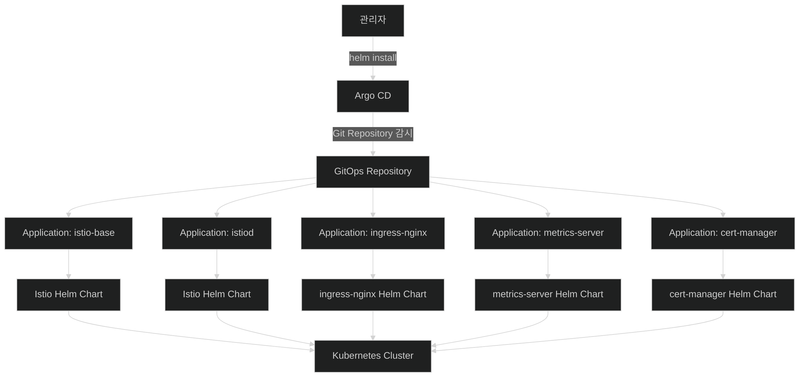

따라서 정확히는 단순히

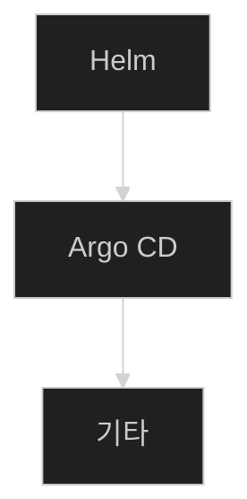

라기보다는

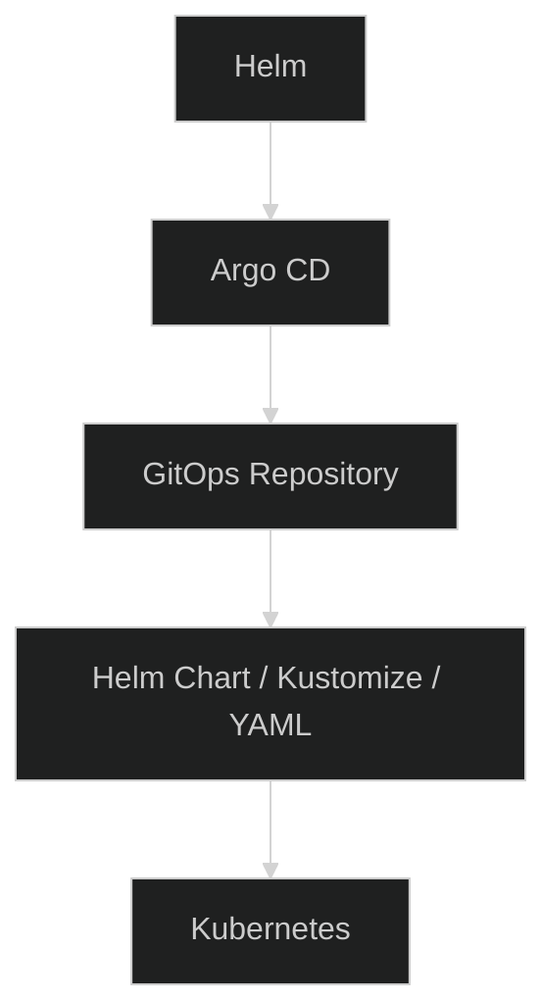

라고 보는 것이 가장 정확합니다.

---

## Helm의 역할

### 최초 Bootstrap

처음 Kubernetes에는 Argo CD 자체가 없습니다.

따라서 Argo CD를 관리해줄 Argo CD가 존재하지 않는 문제가 있습니다.

이것을 "Bootstrap 문제"라고 볼 수 있습니다.

그래서 최초 한 번은 다음처럼 Helm을 직접 사용합니다.

```bash
helm repo add argo https://argoproj.github.io/argo-helm

helm upgrade --install argocd argo/argo-cd \
  -n argocd \
  --create-namespace \
  -f values.yaml
```

그러면 Kubernetes에 Argo CD가 설치됩니다.

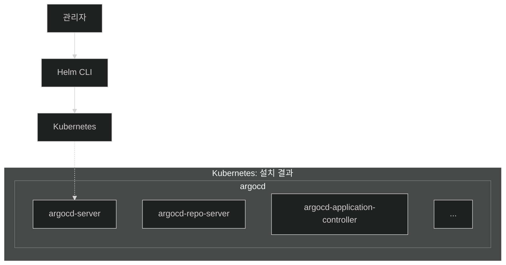

이후부터는 Helm CLI로 이것저것 직접 설치하는 작업을 최소화하는 것입니다.

---

## Argo CD 이후의 인프라 관리

예를 들어 Istio를 설치한다고 하겠습니다.

직접 Helm으로 설치한다면

```bash
helm install istio-base istio/base
helm install istiod istio/istiod
```

처럼 할 수 있습니다.

하지만 GitOps 환경에서는 그렇게 하지 않고 Git에 Argo CD Application을 정의합니다.

예를 들면 개념적으로 다음과 같습니다.

```yaml
apiVersion: argoproj.io/v1alpha1
kind: Application
metadata:
  name: istiod
  namespace: argocd
spec:
  source:
    repoURL: https://istio-release.storage.googleapis.com/charts
    chart: istiod
    targetRevision: 1.x.x

    helm:
      values: |
        profile: default

  destination:
    server: https://kubernetes.default.svc
    namespace: istio-system
```

Argo CD가 이것을 읽으면

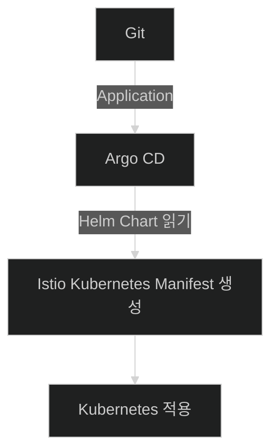

이렇게 동작합니다.

여기서 중요한 점이 하나 있습니다.

"Argo CD를 쓰면 Helm을 안 쓰는 것"은 아닙니다.

오히려

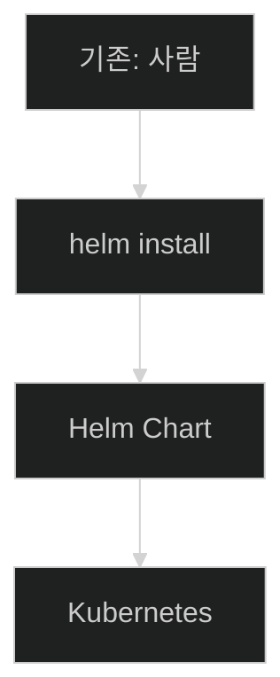

에서

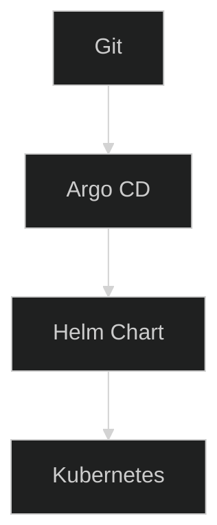

로 Helm을 실행하고 관리하는 주체가 변경되었다고 이해하면 됩니다.

---

## 왜 이렇게 구성하는가

가장 큰 이유는 "설치"보다 "지속적인 상태 관리"가 중요하기 때문입니다.

Helm CLI로 직접 설치하면 다음과 같습니다.

```bash
helm install istio ...
```

누군가 설치했다는 사실은 Kubernetes에는 남지만,

```
누가 설치했는가?
왜 이 values인가?
언제 변경했는가?
운영과 개발 설정 차이가 무엇인가?
Git의 설정과 현재 Kubernetes가 일치하는가?
```

같은 관리가 어려워질 수 있습니다.

Argo CD를 사용하면 Git이 기준이 됩니다.

```
Git

istio:
  version: 1.x.x
  values:
    ...
```

그리고 Argo CD가

```
Git Desired State
       ↕
Kubernetes Actual State
```

를 지속적으로 비교합니다.

차이가 발생하면

```
Synced
OutOfSync
```

등으로 보여줍니다.

필요하면 자동으로 다시 맞출 수도 있습니다.

---

## 추천 관리 구조

실제 GitOps Repository는 이런 형태가 좋습니다.

```
gitops/
├── bootstrap/
│   └── argocd/
│
├── infra/
│   ├── istio/
│   │   ├── base.yaml
│   │   └── istiod.yaml
│   │
│   ├── ingress-nginx/
│   │   └── application.yaml
│   │
│   ├── metrics-server/
│   │   └── application.yaml
│   │
│   ├── cert-manager/
│   │   └── application.yaml
│   │
│   └── external-secrets/
│       └── application.yaml
│
└── apps/
    ├── im-cms/
    ├── im-ams/
    └── im-rsv/
```

역할은 다음처럼 나뉩니다.

| 구분 | 관리 방법 |
| --- | --- |
| Kubernetes 자체 설치 | 별도 |
| Argo CD 최초 설치 | Helm |
| Istio | Argo CD + Helm Chart |
| Ingress Controller | Argo CD + Helm Chart |
| cert-manager | Argo CD + Helm Chart |
| metrics-server | Argo CD + Helm Chart |
| Prometheus/Grafana | Argo CD + Helm Chart |
| 애플리케이션 | Argo CD + Kustomize/Helm |
| 환경별 Manifest | GitOps Repository |

---

## App of Apps까지 적용할 수 있음

여기서 한 단계 더 발전시키면 "App of Apps" 패턴을 사용할 수 있습니다.

예를 들어 Argo CD에 직접 Istio, Metrics Server 등을 하나씩 등록하는 것이 아니라 최상위 Application 하나만 등록합니다.

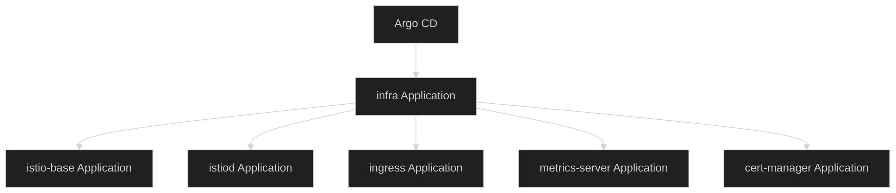

그러면 최초 구축 시 사람이 하는 작업이 거의 다음 두 단계까지 줄어듭니다.

```
1. Helm으로 Argo CD 설치

2. root Application 하나 등록
```

이후에는

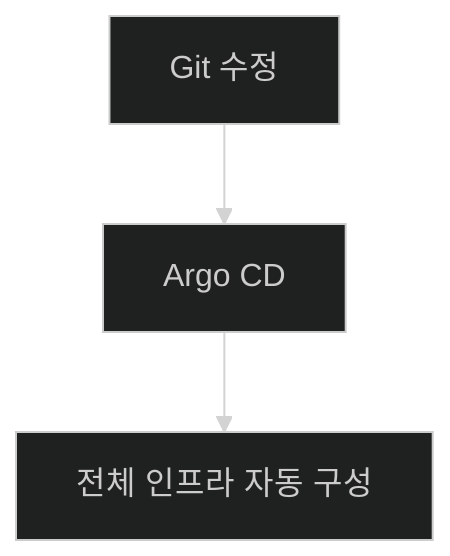

이 됩니다.

이걸 Kubernetes 클러스터의 "Bootstrap 구조"로 사용하기 좋습니다.

---

## 주의해야 할 부분

"모든 것을 무조건 Argo CD로 설치한다"라고 생각할 필요는 없습니다.

Argo CD가 동작하기 전에 반드시 존재해야 하는 것들은 별도의 Bootstrap 영역으로 보는 것이 좋습니다.

예를 들어

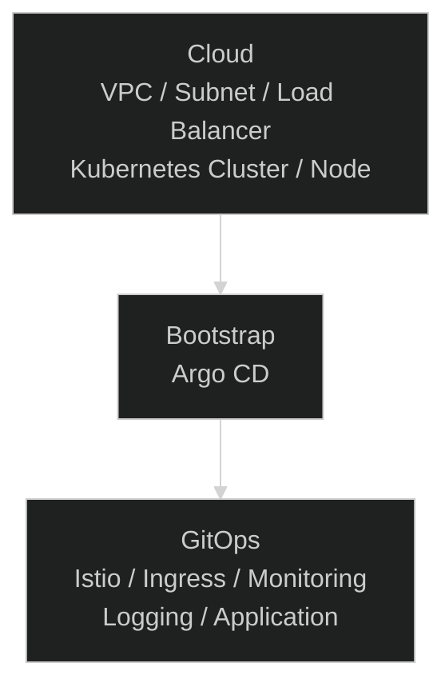

같은 식입니다.

VPC나 Kubernetes Cluster 생성까지 관리하고 싶다면 Terraform/OpenTofu 같은 IaC 도구가 추가됩니다.

그러면 전체 구조가 상당히 깔끔해집니다.

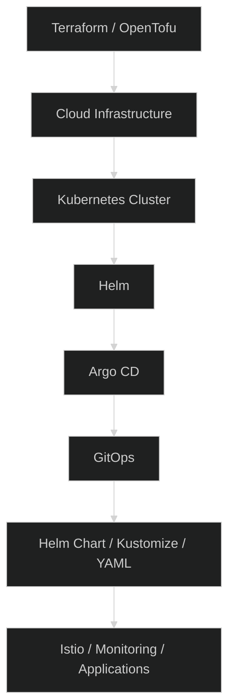

---

## 전체 요약

결론적으로

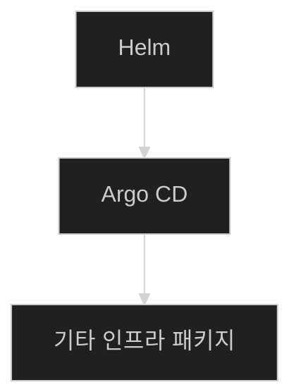

구성은 좋은 방향입니다.

조금 더 정확하게 정리하면 다음과 같습니다.

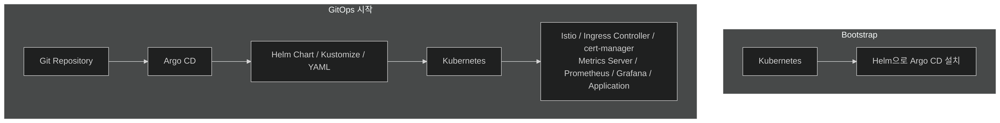

핵심 원칙은 "Helm은 패키징/렌더링 수단이고, Argo CD는 그 패키지의 배포와 지속적인 상태를 관리하는 GitOps 컨트롤러"라는 것입니다.

따라서 실무적으로는 "Argo CD만 최초 Helm으로 Bootstrap하고, 이후 Kubernetes 위에서 관리할 수 있는 인프라 패키지는 최대한 Argo CD 아래로 편입"하는 구조가 관리하기 좋습니다.
