## 개요

Tailscale은 "인터넷에 흩어진 서버와 PC를 하나의 사설 네트워크처럼 연결해주는 Mesh VPN"입니다.

기반 기술은 WireGuard이며, 일반적인 VPN처럼 중앙 VPN 서버를 반드시 거쳐 통신하는 구조가 아니라 가능한 경우 장비끼리 직접 P2P로 연결합니다. Tailscale에서는 이렇게 구성된 사설 네트워크를 "Tailnet"이라고 부릅니다. (tailscale.com)

쉽게 표현하면 다음과 같습니다.

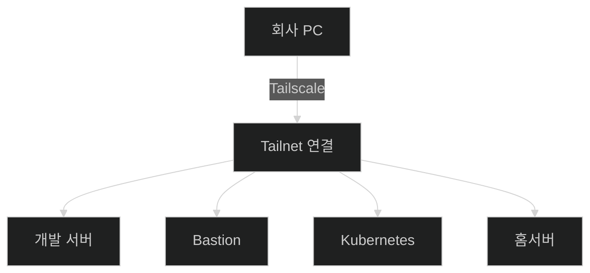

각 장비가 AWS, NCP, 집, 회사처럼 서로 다른 네트워크에 있어도 마치 같은 내부망에 있는 것처럼 접근할 수 있습니다.

---

## 기존 VPN과 차이

전통적인 VPN은 보통 다음 구조입니다.

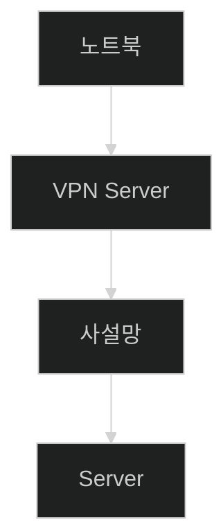

모든 트래픽이 VPN 서버를 거치는 경우가 많습니다.

Tailscale은 기본적으로 다음과 같습니다.

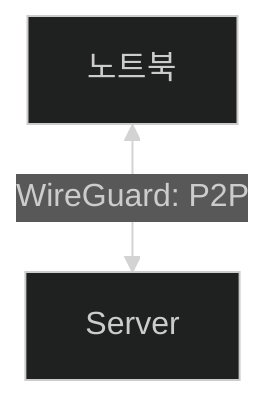

가능하면 NAT Traversal을 이용하여 두 장비가 직접 연결됩니다.

직접 연결할 수 없는 네트워크 환경이면 Peer Relay 또는 Tailscale의 DERP Relay를 이용합니다. 어떤 방식을 사용하더라도 WireGuard 기반으로 종단간 암호화됩니다. (tailscale.com)

즉,

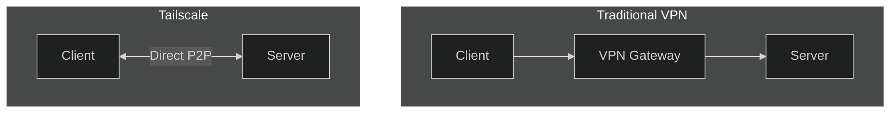

라는 차이가 큽니다.

---

## 동작 방식

### 1. 장비에 Tailscale 설치

예를 들어 다음 장비에 설치합니다.

```
MacBook
개발 Bastion
운영 Bastion
홈서버
```

각 장비가 Tailscale에 인증되면 Tailnet에 등록됩니다.

```
Tailnet

100.x.x.x  MacBook
100.x.x.x  Dev Bastion
100.x.x.x  Prod Bastion
100.x.x.x  Home Server
```

Tailscale 전용 IP가 할당됩니다.

---

### 2. 인증

단순히 VPN 비밀번호를 하나 공유하는 방식이 아니라 사용자와 장비의 Identity를 기반으로 관리할 수 있습니다.

예를 들어

```
Google
Microsoft
GitHub
SSO
```

등의 인증 시스템과 함께 사용할 수 있습니다.

그래서 네트워크 보안을

```
이 IP에서 왔는가?
```

뿐만 아니라

```
누가
어떤 장비로
어떤 서버에
접근할 수 있는가?
```

라는 식으로 제어할 수 있습니다.

---

### 3. Control Plane

Tailscale 서버는 주로 연결을 "관리"합니다.

예를 들어

```
인증
장비 검색
IP 할당
Public Key 교환
접근 정책
DNS
NAT Traversal 정보
```

등을 관리합니다. (tailscale.com)

중요한 것은 실제 데이터가 일반적으로 Tailscale의 Control Plane을 거쳐가는 것은 아니라는 점입니다.

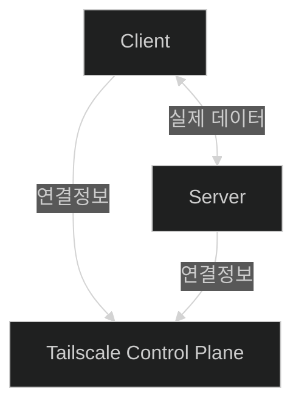

실제 트래픽은 가능한 경우 두 장비가 직접 통신합니다.

---

## 주요 기능

### Tailnet

Tailscale로 묶인 하나의 논리적인 사설 네트워크입니다.

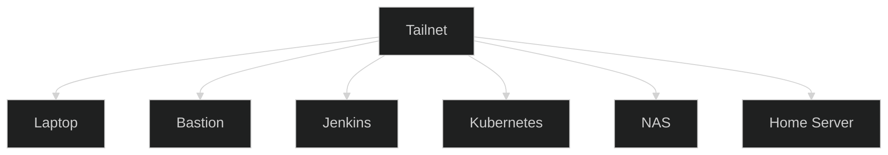

인터넷에 실제로는 서로 떨어져 있어도 논리적으로 하나의 네트워크처럼 사용할 수 있습니다. (tailscale.com)

### MagicDNS

IP 대신 hostname을 사용할 수 있습니다.

예를 들어

```
ssh user@100.x.x.x
```

대신

```
ssh user@dev-bastion
```

같은 식으로 사용할 수 있습니다.

### Grants / ACL

접근 권한을 선언적으로 정의할 수 있습니다.

예를 들어 개념적으로

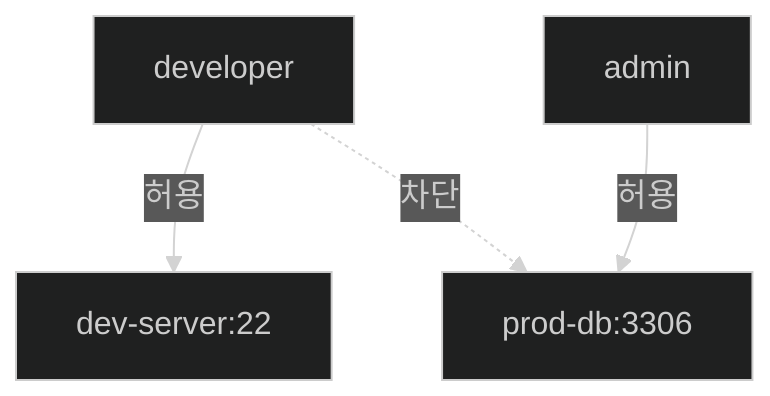

같은 Zero Trust 방식의 접근 제어가 가능합니다.

현재 Tailscale은 새로운 정책을 작성할 때 기존 ACL보다 "Grants" 사용을 권장합니다. ACL도 계속 지원됩니다. (tailscale.com)

---

## Subnet Router

Tailscale의 매우 중요한 기능입니다.

모든 서버에 Tailscale을 설치할 수 없는 경우 하나의 서버를 Gateway처럼 사용할 수 있습니다.

예를 들어 VPC가

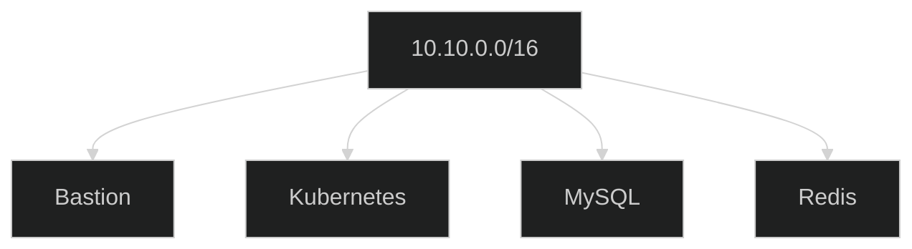

라고 한다면 Bastion만 Tailscale Subnet Router로 만들 수 있습니다.

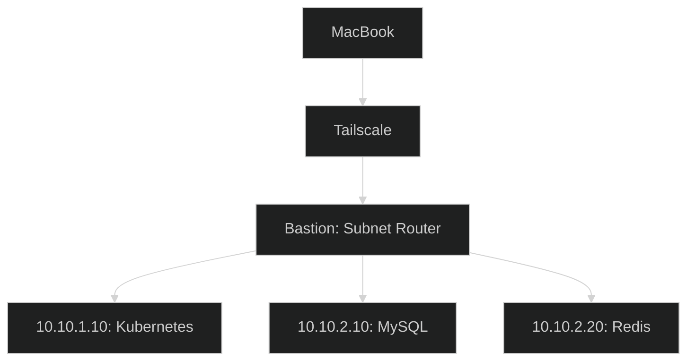

그러면 MySQL이나 Redis에 Tailscale을 직접 설치하지 않아도 접근할 수 있습니다. Subnet Router는 특정 private subnet으로 가는 경로를 Tailnet에 제공하는 역할입니다. (tailscale.com)

DevOps 인프라에서는 상당히 유용한 기능입니다.

---

## Exit Node

Subnet Router와 약간 다릅니다.

Subnet Router:

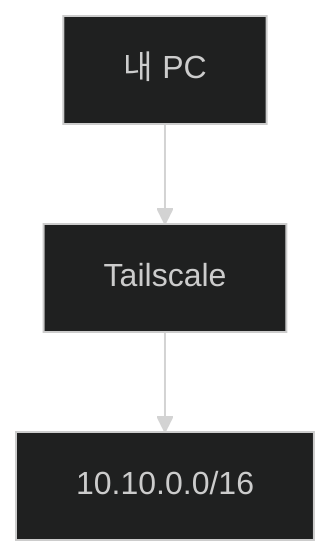

특정 사설망으로 가는 트래픽만 전달합니다.

Exit Node:

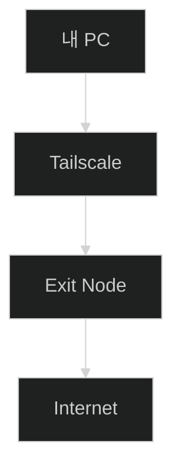

인터넷 트래픽 자체를 특정 Tailscale 장비를 통해 내보냅니다. 즉 전통적인 VPN Gateway와 비슷하게 사용할 수 있습니다. (tailscale.com)

---

## Kubernetes와 Tailscale

Tailscale은 Kubernetes Operator도 공식적으로 제공합니다.

예를 들어 Kubernetes API Server를 인터넷에 공개하지 않고

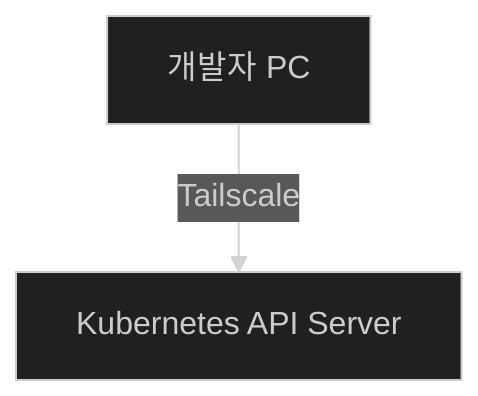

형태로 접근할 수 있습니다.

또한

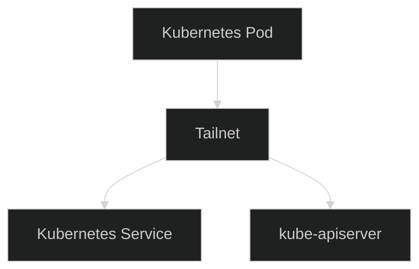

모두 지원합니다. (tailscale.com)

Operator는 Helm으로도 설치할 수 있습니다. (tailscale.com)

그래서 Kubernetes 인프라에서는 다음과 같은 구조도 가능합니다.

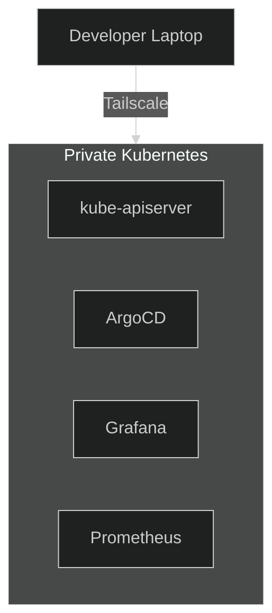

이렇게 하면 관리용 서비스를 굳이 Public IP로 노출하지 않아도 됩니다.

---

## Bastion과 비교

여기서 Bastion과 역할이 겹쳐 보일 수 있습니다.

기존 방식은

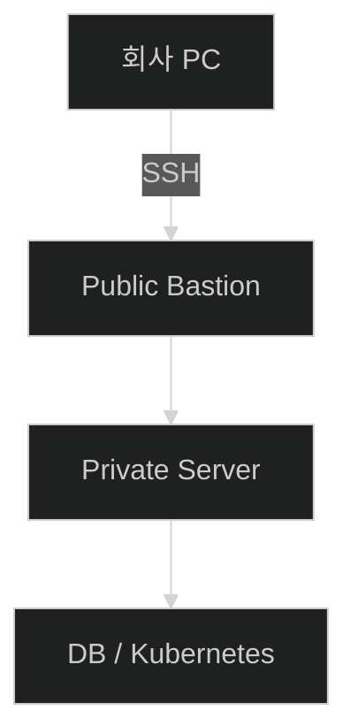

입니다.

Tailscale을 도입하면

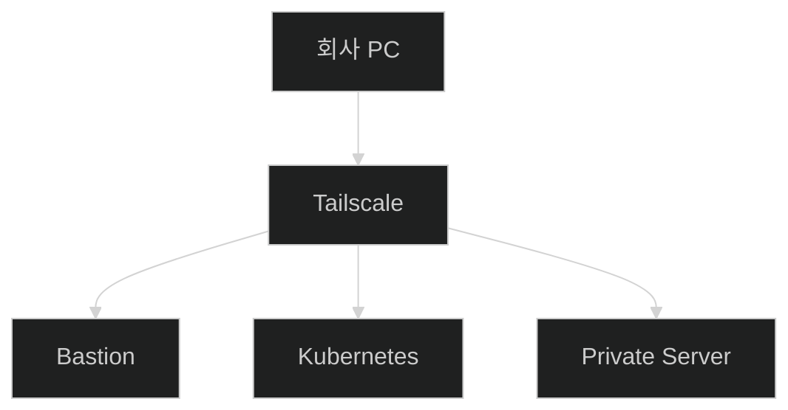

처럼 구성할 수 있습니다.

심지어 환경에 따라서는 관리 목적으로 Public Bastion을 둘 필요 자체가 크게 줄어듭니다.

예를 들어 SSH 22 포트를 인터넷에

```
회사IP/32 → Bastion:22
```

로 열어 놓는 대신

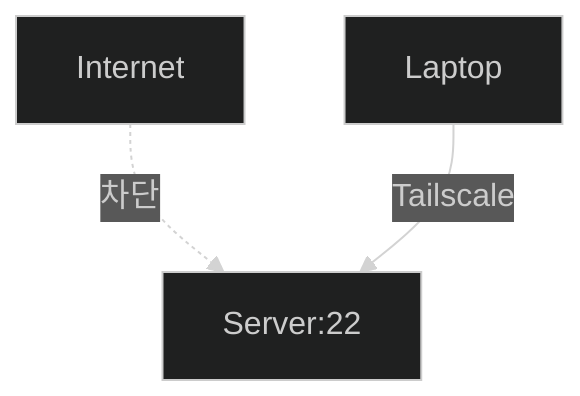

방식으로 관리할 수 있습니다.

이 점 때문에 Tailscale이 홈서버뿐 아니라 DevOps 인프라 관리에서도 많이 사용됩니다.

---

## 어떤 상황에서 좋은가

특히 다음과 같은 환경에 잘 맞습니다.

| 상황 | Tailscale |
| --- | --- |
| 홈서버 원격 접속 | 매우 적합 |
| 개발서버 SSH | 매우 적합 |
| Bastion 접근 | 적합 |
| Kubernetes API 접근 | 매우 적합 |
| ArgoCD/Grafana 내부 접근 | 매우 적합 |
| DB 터널링 대체 | 적합 |
| 여러 클라우드 연결 | 적합 |
| 회사 VPN 대체 | 환경에 따라 가능 |
| 일반 사용자 웹서비스 공개 | 주 목적은 아님 |

특히

```
AWS
NCP
온프레미스
홈서버
개발자 PC
```

처럼 네트워크가 여러 군데 흩어져 있을수록 장점이 커집니다.

---

## 전체 요약

Tailscale은 한마디로

> "WireGuard를 기반으로 복잡한 VPN 구축 없이 여러 장비를 하나의 안전한 사설망으로 묶어주는 서비스"
> 

라고 보면 됩니다.

핵심 구조는 다음과 같습니다.

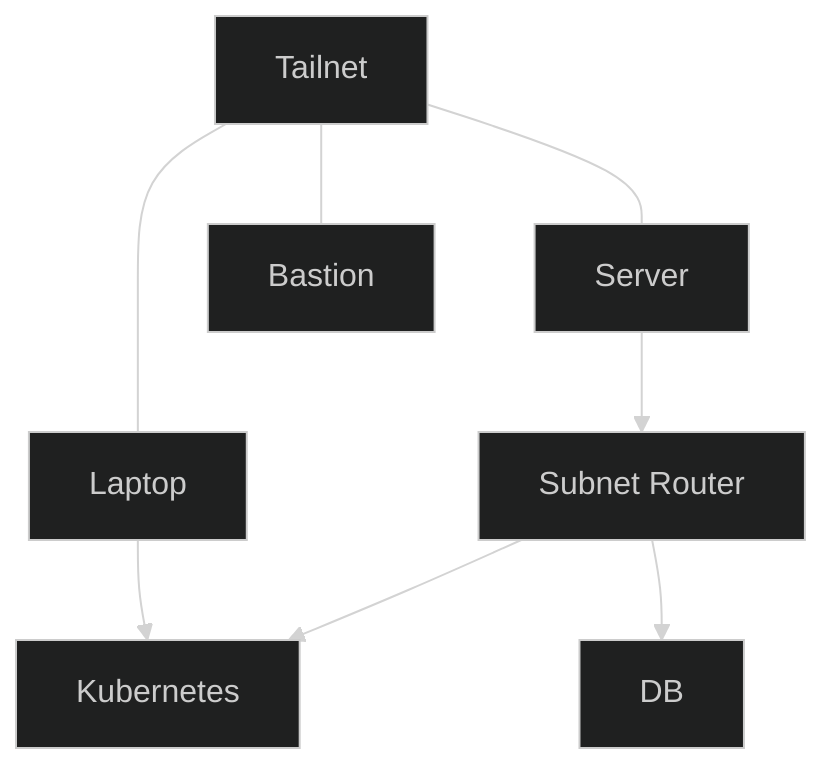

특히 DevOps에서는 "Public IP + Bastion + IP Whitelist + VPN"으로 관리하던 부분을 상당히 단순화할 수 있다는 점이 핵심입니다.
