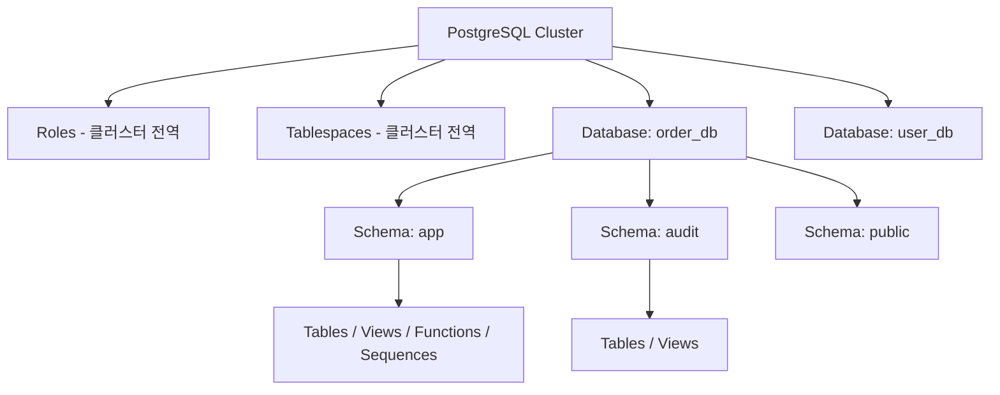
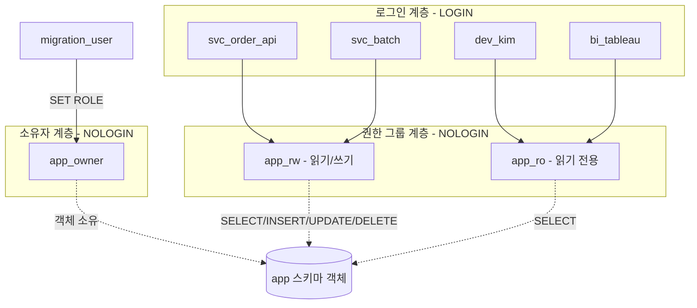

## 개요

PostgreSQL에서 객체는 "클러스터 → 데이터베이스 → 스키마 → 객체(테이블, 뷰, 함수 등)"의 계층 구조로 관리됩니다.
운영 환경에서는 이 계층마다 "무엇을 분리하고, 누구에게 어떤 권한을 줄 것인가"를 정책으로 정해 두어야 보안·운영·확장성을 함께 확보할 수 있습니다.

핵심 원칙은 다음 세 가지입니다.

- Database는 "강한 격리 단위"로, 서비스나 도메인 단위로 나눕니다.
- Schema는 "논리적 네임스페이스이자 권한 경계"로, 모듈이나 용도 단위로 나눕니다.
- 계정은 "역할(Role) 기반 접근 제어(RBAC)"로 설계하고, 로그인 계정과 권한 그룹을 분리하며 최소 권한 원칙을 적용합니다.

---

## PostgreSQL 객체 계층 구조

### 클러스터와 전역 객체

PostgreSQL 인스턴스 하나를 "클러스터"라고 부릅니다. 클러스터 안에는 여러 데이터베이스가 존재하며, 다음 객체는 클러스터 전역에서 공유됩니다.

- Role(사용자/그룹)
- Tablespace
- 데이터베이스 목록 자체

즉, 계정(Role)은 특정 데이터베이스에 종속되지 않고 클러스터 전체에서 하나의 이름으로 존재합니다. 이 점이 MySQL 등과의 큰 차이이며, 계정 정책을 설계할 때 반드시 고려해야 합니다.

### 데이터베이스와 스키마의 관계



- 데이터베이스 간에는 일반 SQL로 조인할 수 없습니다. (dblink, postgres_fdw 같은 확장이 필요)
- 같은 데이터베이스 내 스키마 간에는 `schema.table` 형태로 자유롭게 조인할 수 있습니다.

이 차이가 "무엇을 DB로 나누고, 무엇을 스키마로 나눌지"를 결정하는 가장 중요한 기준입니다.

---

## Database 정책

### 데이터베이스를 나누는 기준

#### 강한 격리가 필요한 경우 DB 분리

다음과 같은 경우 별도 데이터베이스로 분리하는 것이 좋습니다.

- 서로 다른 서비스(마이크로서비스)로, 데이터를 직접 조인할 일이 없는 경우
- 백업·복구·마이그레이션 주기가 서로 다른 경우
- 멀티 테넌트 환경에서 고객사별 완전 격리가 계약상 요구되는 경우
- 인코딩, Collation, 확장(Extension) 구성이 서로 달라야 하는 경우

#### 조인이 잦다면 같은 DB, 다른 스키마

같은 애플리케이션의 모듈들처럼 서로 조인이 빈번하다면 DB를 쪼개지 말고 스키마로 나누는 것이 바람직합니다. DB를 나누면 크로스 조인이 불가능해 애플리케이션 레벨 조인이나 FDW를 써야 하므로 복잡도가 크게 올라갑니다.

### 데이터베이스 생성 시 고려 사항

#### 소유자(Owner)

데이터베이스 소유자는 superuser(`postgres`)가 아니라 전용 "owner role"로 지정하는 것이 원칙입니다. 소유자는 해당 DB에 대해 거의 모든 권한을 가지므로, 애플리케이션 접속 계정과는 반드시 분리해야 합니다.

#### 인코딩과 Collation

- 인코딩은 거의 항상 `UTF8`을 사용합니다.
- Collation은 정렬과 인덱스 동작에 영향을 주며, 생성 후 변경이 어렵습니다. 한국어 정렬이 중요하면 `ko_KR.UTF-8` 또는 ICU Collation을 고려하고, 성능·이식성을 중시하면 `C`를 선택하기도 합니다.

#### template1 관리

새 DB는 기본적으로 `template1`을 복제해 생성됩니다. 따라서 `template1`에 불필요한 객체나 권한이 있으면 모든 신규 DB로 전파됩니다. 공통으로 필요한 확장만 넣어 두고 깨끗하게 유지하는 것이 좋습니다.

### 접속 제어

#### CONNECT 권한

PostgreSQL은 기본적으로 `PUBLIC`(모든 role)에게 데이터베이스 `CONNECT`와 `TEMPORARY` 권한을 부여합니다. 운영 환경에서는 이를 회수(REVOKE)하고 필요한 role에만 명시적으로 부여하는 것이 정석입니다.

#### pg_hba.conf

네트워크 레벨 접근 제어는 `pg_hba.conf`에서 이루어집니다.

- 어떤 DB에, 어떤 사용자가, 어떤 IP 대역에서, 어떤 인증 방식으로 접속할 수 있는지 규칙으로 정의합니다.
- 인증 방식은 `scram-sha-256`을 사용하고, `trust`나 `md5`는 피합니다. (PG14부터 기본 암호 방식이 scram-sha-256입니다)
- superuser의 원격 접속은 차단하는 것이 권장됩니다.

#### 연결 수 제한

DB 단위(`ALTER DATABASE ... CONNECTION LIMIT`) 또는 role 단위(`ALTER ROLE ... CONNECTION LIMIT`)로 최대 연결 수를 제한해, 특정 서비스가 커넥션을 독점하지 못하게 할 수 있습니다.

---

## Schema 정책

### 스키마의 역할

스키마는 두 가지 역할을 동시에 합니다.

- 네임스페이스: 같은 이름의 테이블을 스키마별로 둘 수 있습니다.
- 권한 경계: 스키마 단위로 `USAGE`, `CREATE` 권한을 제어할 수 있습니다.

스키마 안의 객체에 접근하려면 "스키마에 대한 USAGE 권한"과 "객체 자체에 대한 권한"이 모두 필요합니다. 테이블에 SELECT 권한을 줬는데도 조회가 안 된다면 대부분 스키마 USAGE가 빠진 경우입니다.

### public 스키마 정책

#### 버전별 기본 동작 차이

- PG14 이하: `PUBLIC`(모든 사용자)이 `public` 스키마에 `CREATE` 권한을 가집니다. 즉 아무 계정이나 테이블을 만들 수 있었습니다.
- PG15 이상: `public` 스키마의 `CREATE` 권한이 `PUBLIC`에서 제거되었고, 스키마 소유자도 `pg_database_owner`로 바뀌었습니다.

#### 권장 정책

- PG14 이하라면 `REVOKE CREATE ON SCHEMA public FROM PUBLIC;`을 반드시 수행합니다.
- 애플리케이션 객체는 `public`에 두지 말고 전용 스키마를 만드는 것을 권장합니다.
- 아예 `public` 스키마를 사용하지 않거나 삭제하는 조직도 많습니다.

### search_path 정책

#### search_path의 의미

`search_path`는 스키마를 명시하지 않은 객체 이름을 찾을 때 탐색하는 스키마 순서입니다. 기본값은 `"$user", public`입니다.

#### 보안상 주의점

`search_path`에 쓰기 가능한 스키마가 앞쪽에 있으면, 악의적인 사용자가 같은 이름의 함수나 테이블을 만들어 다른 사용자의 쿼리를 가로챌 수 있습니다. (CVE-2018-1058 계열 이슈)

- role 또는 DB 단위로 `search_path`를 명시적으로 고정합니다.
- `SECURITY DEFINER` 함수에는 반드시 `SET search_path`를 지정합니다.
- 운영 코드에서는 가능하면 `schema.table`처럼 스키마를 명시합니다.

### 스키마 분리 패턴

#### 용도별 분리

가장 흔한 패턴입니다.

| 스키마 | 용도 |
| --- | --- |
| app | 애플리케이션 핵심 테이블 |
| audit | 감사 로그, 이력 테이블 |
| stage | ETL 적재용 임시 테이블 |
| report | 분석·리포팅용 뷰 |
| ext | 확장(Extension) 설치용 |

#### 도메인(모듈)별 분리

모놀리식 애플리케이션에서 `order`, `member`, `payment`처럼 도메인별로 스키마를 나누면, 나중에 마이크로서비스로 분리할 때 경계가 명확해집니다.

#### 테넌트별 분리

고객사마다 스키마를 하나씩 두는 방식(schema-per-tenant)입니다. DB 분리보다 가볍고 공유 테이블보다 격리가 강하지만, 테넌트가 수천 개 이상으로 늘어나면 카탈로그 비대화와 마이그레이션 부담이 커집니다.

---

## 계정(Role) 정책

### Role의 개념

PostgreSQL에는 "user"와 "group"의 구분이 없고 모두 "role"입니다.

- `LOGIN` 속성이 있으면 사용자처럼 접속할 수 있습니다.
- `LOGIN`이 없으면 권한 묶음(그룹)으로 사용됩니다.
- role은 다른 role의 멤버가 될 수 있으며, `INHERIT` 속성에 따라 권한을 자동 상속합니다.

### 계층형 Role 설계 (RBAC)

#### 3계층 구조

실무에서 가장 널리 쓰이는 구조는 다음과 같습니다.



- 소유자 role: 스키마와 객체를 소유하며 DDL을 수행합니다. 로그인 불가로 두고, 마이그레이션 계정이 `SET ROLE`로 전환해 사용합니다.
- 권한 그룹 role: `rw`, `ro` 같은 권한 묶음입니다. 로그인 불가입니다.
- 로그인 role: 실제 사람이나 애플리케이션이 접속하는 계정으로, 직접 권한을 갖지 않고 그룹 role의 멤버가 됩니다.

#### 이 구조의 장점

- 권한 변경 시 그룹 role만 수정하면 모든 멤버에게 반영됩니다.
- 계정 퇴사·교체 시 로그인 role만 삭제하면 되고, 객체 소유권 문제가 발생하지 않습니다.
- 애플리케이션 계정이 DDL 권한을 갖지 않으므로 SQL Injection 피해 범위가 줄어듭니다.

### 최소 권한 원칙

#### 특수 속성 제한

| 속성 | 의미 | 정책 |
| --- | --- | --- |
| SUPERUSER | 모든 권한 검사 우회 | DBA 비상용 1개만, 원격 접속 차단 |
| CREATEDB | DB 생성 | 일반 계정 부여 금지 |
| CREATEROLE | role 생성/변경 | 계정 관리 전용 role에만 |
| REPLICATION | 복제 접속 | 복제 전용 계정에만 |
| BYPASSRLS | RLS 우회 | 원칙적으로 금지 |

#### 기본 제공 role 활용

PG14 이상에서는 미리 정의된 role을 활용하면 superuser 없이도 운영 작업을 위임할 수 있습니다.

- `pg_read_all_data`, `pg_write_all_data`: 모든 테이블 읽기/쓰기
- `pg_monitor`: 모니터링 뷰 조회
- `pg_signal_backend`: 다른 세션 취소/종료
- `pg_maintain`(PG17): VACUUM, ANALYZE, REINDEX 등 유지보수

### DEFAULT PRIVILEGES

#### 왜 필요한가

`GRANT SELECT ON ALL TABLES IN SCHEMA app TO app_ro;`는 "실행 시점에 존재하는 테이블"에만 적용됩니다. 이후 새로 만든 테이블에는 권한이 자동으로 붙지 않습니다.

#### 해결 방법

`ALTER DEFAULT PRIVILEGES`로 "앞으로 특정 role이 생성할 객체"에 대한 기본 권한을 미리 정의합니다. 주의할 점은 이 설정이 "객체를 생성하는 role" 기준이라는 것입니다. 따라서 DDL은 항상 소유자 role로 수행하도록 통일해야 기본 권한이 일관되게 적용됩니다.

### 계정 보안 운영

- 비밀번호는 `scram-sha-256`으로 저장합니다. (`password_encryption = scram-sha-256`)
- `VALID UNTIL`로 계정 만료일을 지정해 임시 계정을 관리합니다.
- role 단위로 `statement_timeout`, `idle_in_transaction_session_timeout`, `search_path`를 설정할 수 있습니다.
- 사람 계정과 애플리케이션 계정을 분리하고, 계정 공유를 금지합니다.
- `pgaudit` 확장으로 DDL과 권한 변경 이력을 감사 로그로 남깁니다.
- 테이블 내부 행 단위 접근 제어가 필요하면 Row Level Security(RLS)를 활용합니다.

---

## 정책 적용 예시

### Database 생성과 접속 제어

```sql
-- 소유자 role 생성 (로그인 불가)
CREATE ROLE app_owner NOLOGIN;

-- DB 생성
CREATE DATABASE order_db
  OWNER app_owner
  ENCODING 'UTF8'
  TEMPLATE template0
  LC_COLLATE 'C' LC_CTYPE 'C';

-- 기본 CONNECT/TEMP 권한 회수
REVOKE ALL ON DATABASE order_db FROM PUBLIC;
```

### Schema 생성과 public 정리

```sql
\c order_db

-- public 스키마 생성 권한 회수 (PG14 이하 필수)
REVOKE CREATE ON SCHEMA public FROM PUBLIC;

-- 전용 스키마
CREATE SCHEMA app AUTHORIZATION app_owner;
CREATE SCHEMA audit AUTHORIZATION app_owner;
```

### 권한 그룹 role 구성

```sql
CREATE ROLE app_rw NOLOGIN;
CREATE ROLE app_ro NOLOGIN;

GRANT CONNECT ON DATABASE order_db TO app_rw, app_ro;
GRANT USAGE ON SCHEMA app TO app_rw, app_ro;

-- 기존 객체
GRANT SELECT, INSERT, UPDATE, DELETE ON ALL TABLES IN SCHEMA app TO app_rw;
GRANT USAGE, SELECT ON ALL SEQUENCES IN SCHEMA app TO app_rw;
GRANT SELECT ON ALL TABLES IN SCHEMA app TO app_ro;

-- 앞으로 app_owner가 만들 객체
ALTER DEFAULT PRIVILEGES FOR ROLE app_owner IN SCHEMA app
  GRANT SELECT, INSERT, UPDATE, DELETE ON TABLES TO app_rw;
ALTER DEFAULT PRIVILEGES FOR ROLE app_owner IN SCHEMA app
  GRANT USAGE, SELECT ON SEQUENCES TO app_rw;
ALTER DEFAULT PRIVILEGES FOR ROLE app_owner IN SCHEMA app
  GRANT SELECT ON TABLES TO app_ro;
```

### 로그인 계정 생성

```sql
-- 애플리케이션 계정
CREATE ROLE svc_order_api LOGIN PASSWORD '***' CONNECTION LIMIT 50;
GRANT app_rw TO svc_order_api;
ALTER ROLE svc_order_api SET search_path = app;
ALTER ROLE svc_order_api SET statement_timeout = '30s';

-- 마이그레이션 계정 (DDL은 app_owner로 전환해 수행)
CREATE ROLE migration_user LOGIN PASSWORD '***';
GRANT app_owner TO migration_user;
-- 사용 시: SET ROLE app_owner;

-- 개발자 조회 계정 (만료일 지정)
CREATE ROLE dev_kim LOGIN PASSWORD '***' VALID UNTIL '2027-06-30';
GRANT app_ro TO dev_kim;
```

### pg_hba.conf 예시

```
# TYPE  DATABASE   USER            ADDRESS          METHOD
local   all        postgres                         peer
host    order_db   svc_order_api   10.0.10.0/24     scram-sha-256
host    order_db   +app_ro         10.0.20.0/24     scram-sha-256
host    all        postgres        0.0.0.0/0        reject
```

`+app_ro`처럼 앞에 `+`를 붙이면 해당 role의 멤버 전체에 규칙이 적용됩니다.

---

## 전체 요약

| 구분 | 핵심 정책 |
| --- | --- |
| Database | 서비스·격리 단위로 분리, 전용 owner role 지정, `PUBLIC`의 CONNECT 회수, `pg_hba.conf`로 네트워크 제어 |
| Schema | 모듈·용도 단위로 분리, `public` 스키마 CREATE 회수 또는 미사용, `search_path` 고정 |
| 계정(Role) | 소유자 / 권한 그룹 / 로그인 3계층 RBAC, 최소 권한, DEFAULT PRIVILEGES로 신규 객체 권한 자동화 |
| 보안 운영 | scram-sha-256 인증, superuser 원격 차단, 계정 만료·타임아웃 설정, pgaudit·RLS 활용 |

정리하면 "DB는 강한 격리, 스키마는 논리적 경계, Role은 계층형 권한 묶음"으로 역할을 나누고, 애플리케이션 계정은 DDL 권한 없이 그룹 role을 통해서만 필요한 DML 권한을 받도록 설계하는 것이 PostgreSQL 권한 정책의 기본입니다.